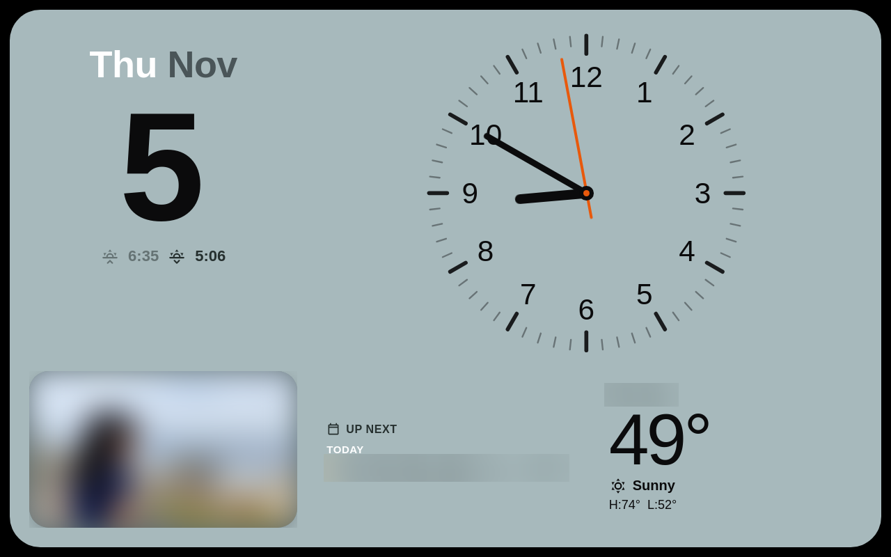
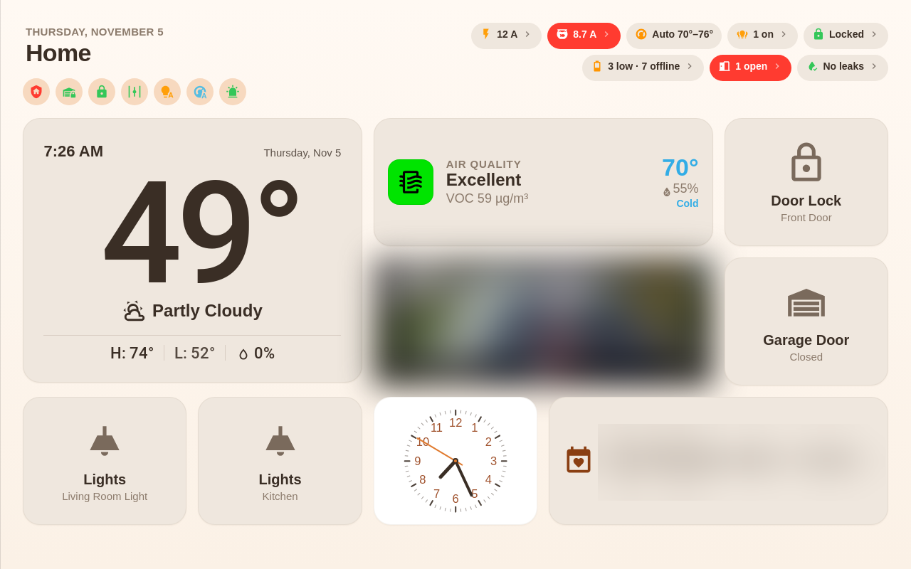
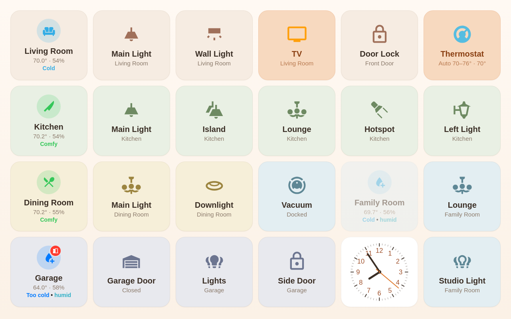
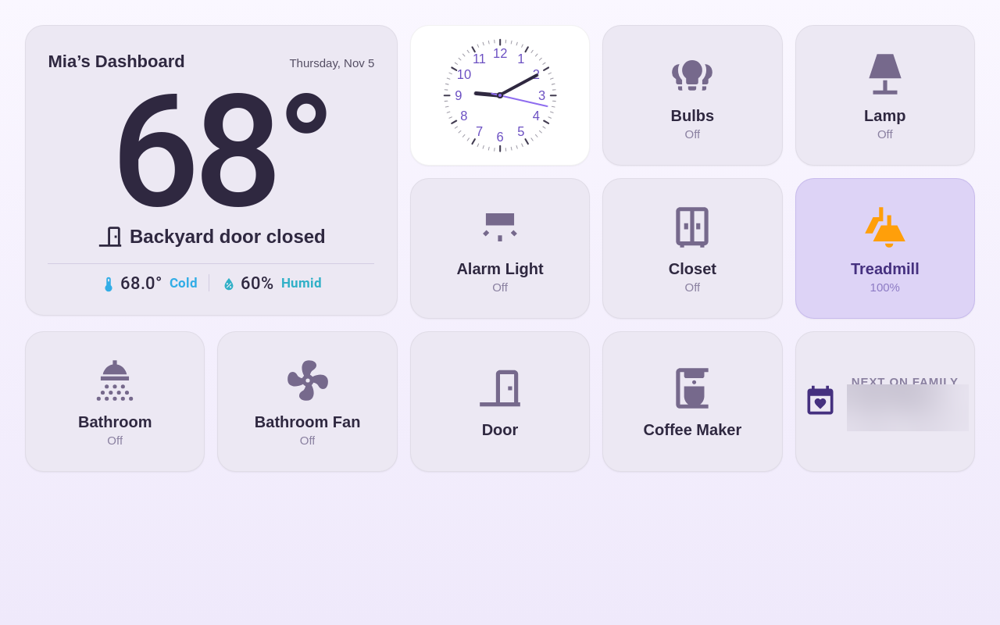
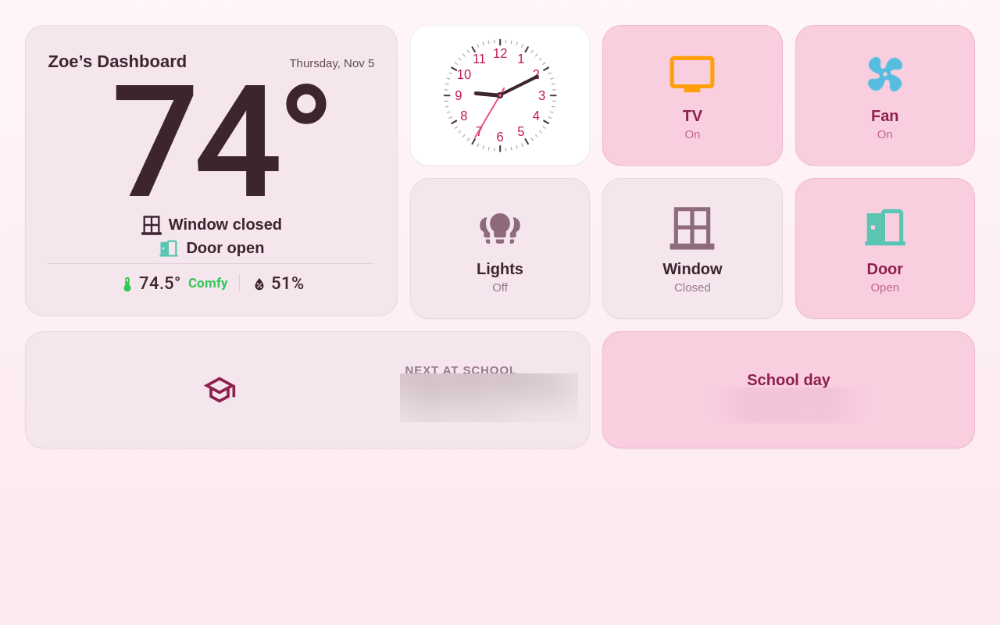
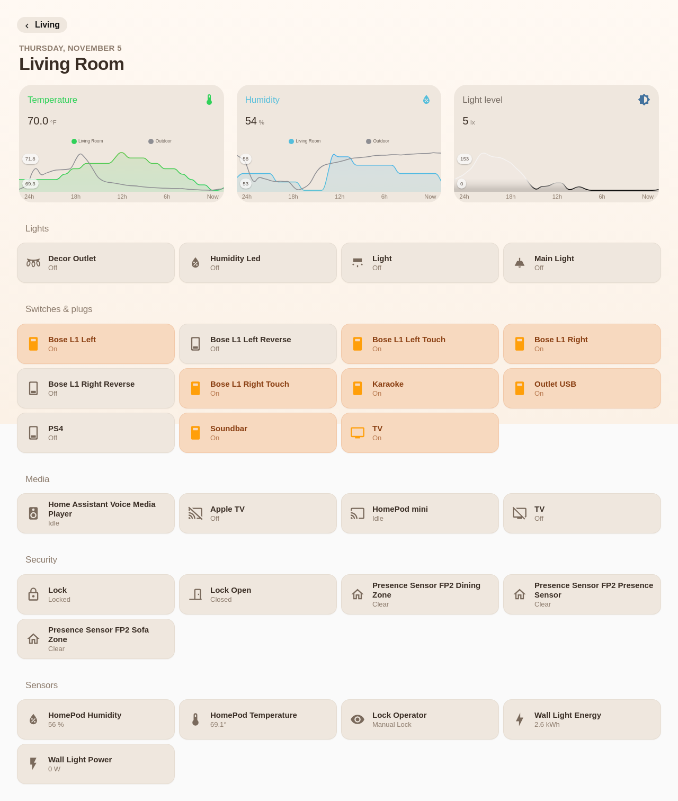
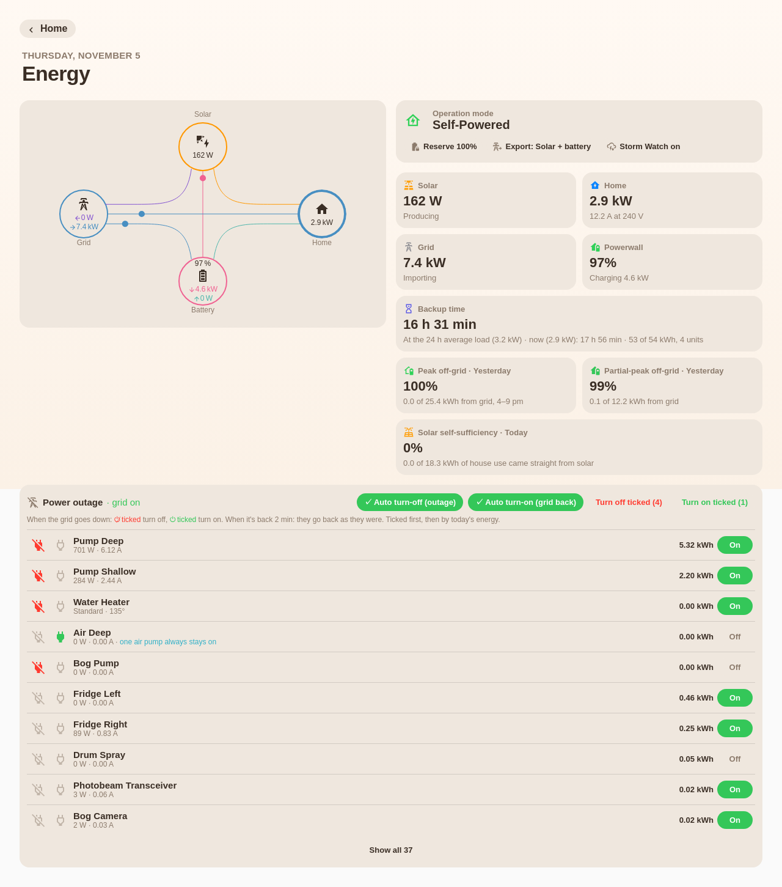
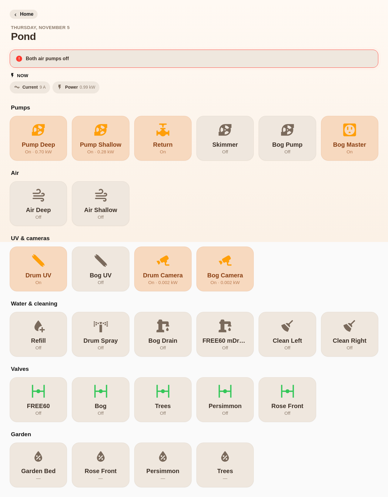
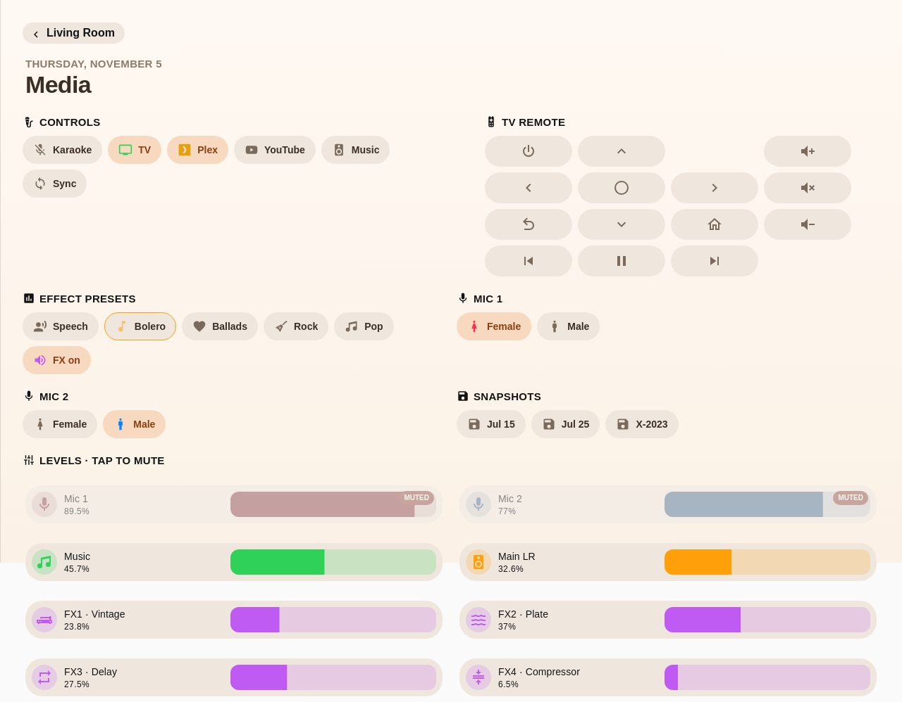
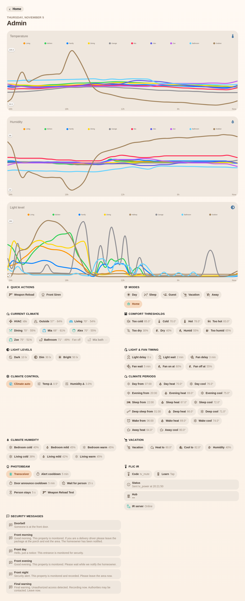

# HomeView

An Apple-Home-style dashboard for Home Assistant that **builds itself from your home**.

HomeView reads your areas, floors, devices and entities and generates a complete dashboard —
Widgets, Home, Living, Rooms (plus a page for every room), Energy and Cameras — that works on
an iPhone, an iPad, a wall tablet and a desktop browser. Add a device to an area and it shows up;
no YAML per tile.

- **Zero setup:** one line of config. Rooms, people (and a page for each, from their
  `person` entities), calendars, weather, cameras and energy are found automatically.
- **Easy to make your own:** double-tap a page's title to rename, resize, hide or pin tiles right on the
  dashboard, use the settings editor for everything else, or YAML if you prefer.
- **No other cards needed:** HomeView draws its own tiles. You don't need button-card,
  card-mod, layout-card or anything else from HACS.
- **One dashboard for every screen:** 2 square tiles across on a phone; 5 across on an iPad,
  a tablet and a browser (6 on the room-list pages), square on an iPad and a little wider than
  tall (1.28 : 1, or 1.1 : 1 with 6 across) on screens wider than 3:2 — like the Pixel Tablet — so
  a page fits the screen. Very wide screens get more columns.
- **Light and dark:** follows your Home Assistant theme, each page and room with its own tint.
  Home Assistant cards on a page (charts, the energy cards, tables, buttons) follow HomeView's look
  too — light, dark or night, even when HA's own theme is the other one.
- **Full screen like an app:** HA's header and sidebar are always hidden when HomeView opens; a small Menu icon in front of the Home title brings them back (on phones and iPads it opens the sidebar too, so Settings is one tap away).
- **Touch-first:** tap toggles, hold opens the details — a room's tile toggles its lights and
  holding it opens the room's details page (✕ top right or Esc: back to where you were). Swipe left
  / right between pages, one page per swipe, from anywhere on the page (a slider or fader keeps its
  own drag).

> Status: **0.8 (preview)**. The layout and config keys may still change before 1.0.
> Use at your own risk — see [Disclaimer](#disclaimer).

## Contents

- [Pages](#pages) · [A real home, fine-tuned](#a-real-home-fine-tuned) · [What you need](#what-you-need) · [Install](#install) · [Create the dashboard](#create-the-dashboard) · [Full screen](#full-screen-kiosk-mode) · [Night](#night) · [Guest view](#guest-view)
- [Make it yours](#make-it-yours): [on the dashboard](#1-on-the-dashboard-double-tap-the-title) ·
  [settings editor](#2-the-settings-editor) · [YAML](#3-yaml)
- [Your own tiles, cards and pages](#your-own-tiles-cards-and-pages) · [All options](#all-options)
- [Taps](#taps) · [Report a problem](#report-a-problem) · [Credits](#credits) · [Disclaimer](#disclaimer)

## Pages

| Page | What's on it |
|---|---|
| **Widgets** | One tinted panel that fills the screen: a big date with sunrise / sunset, a big analog clock, the forecast, the week's agenda and a **photo slideshow** from a media folder (sample photos until you add your own). On a phone: date and clock side by side, the photo, then up next |
| **Home** | One screen, like a hand-made dashboard: date, title, **control chips** (alarm, garage, locks, water valve — red with a word when something needs attention), people, and the **status pills** top right (alarm, climate, power now, lights on, locks, doors & windows, leaks / smoke, batteries, now playing, plus your pages' own pills); weather (2×2), air quality (2×1), two doors (front lock, garage), a camera (2×1), *Lights* for the two main rooms (tap = all on / off, hold = the room); your scenes; then a clock and the next event (2×1) |
| **Living** | The living spaces everyone shares — living room, kitchen, dining, family room, garage … — each in its own colour with its lights, climate, locks, covers, fans and media. Bedrooms, bathrooms and outdoor areas are left out (they have their own pages). Choose the rooms with `living_rooms` |
| **Rooms** — a page per person | One page for each family member (Alex, Zoe, Mia …), found from your `person` entities: their room's temperature, comfort, humidity, doors and windows, its devices, their next event and where they are. Automatic for everyone with a room named after them ("Bedroom Zoe"); `members` sets who and in what order. Each person sees only their own page unless `access` says otherwise (admins see all) |
| **Room pages** | A room's details — hold a room's tile or title: *Right now* (temperature, comfort, humidity, its doors and locks), quick tiles (all its lights on / off, presence, power now), 24-hour charts (temperature, humidity, light level), then everything in the room: lights, climate, doors & security, media, devices, scenes, cameras, sensors |
| **Energy** | Opened from the Energy pill (or in the page bar). A live flow diagram; *right now* (solar, home with amps · volts, grid importing / exporting, battery charging / discharging); **backup time** on battery; **off-grid share in your peak hours** (optional time windows); **solar self-sufficiency**; today's totals; and a **power-outage list** of every device with W · A · kWh today and an on / off button (admins; it asks first) — tick what to turn off when the grid goes down ([Power outages](#power-outages)). The flow is [Power Flow Card Plus](https://github.com/flixlix/power-flow-card-plus) when it's installed (HomeView's own otherwise); the numbers are live between meter readings |
| **Cameras** | Every camera, refreshed every 10 s while on screen. Up to nine fill one tablet or browser screen (up to 3 across, 16:9, no scrolling); more, or a phone: a grid that scrolls. An offline camera says so (amber badge, "Offline"). Tap for the live stream |
| **All rooms** *(optional)* | A directory of every room (by floor). Add `all_rooms` to `pages`. It's also what `rooms` shows in a home without member rooms |
| **People** *(optional)* | Everyone with home / away, since when and phone battery, plus the family calendar. Add `people` to `pages` to use it |
| **Your pages** | As many as you like, with your own tiles and any Home Assistant card |

The pages come in this order, and swiping past the last one wraps back to Widgets.
**On a phone** every page follows a hand-made iPhone HomeView: a big title (*Hi <your name>* on
Living and each person's page, with a strip of six favourites), compact one-line tiles two
across, each room starting with a slim bar (name, comfort, temperature · humidity), wide tiles
(weather, air, camera, next event) across the full width, no clock. Status pills are on Home only, under the chips
(top right on tablets and in a browser). On every screen anything that needs attention comes first (red,
then amber), and the pills **wrap onto as many lines as they need**; on a phone the chips and people
share one row. Nothing on Home scrolls sideways, so a sideways swipe anywhere there changes the page.
**Home on a phone puts the
controls first** — favourites and Lights, then the scenes two to a row, then the weather (one compact
line), camera, next event and air quality — and **phones open on Home** (tablets on the first page,
Widgets); `start:` changes that.
Favourites: `phone_favorites: [light.kitchen, …]` or per person
`{ alex: [...], zoe: [...] }` (default: the main rooms' lights, then the locks).

Pages that have nothing to show (no cameras, no energy set up …) are left out.

The pills open a sheet with the matching devices, for example every light that's on or every
open door, and you can control them right there. Locks, doors & windows, leaks and batteries list
what needs a look first, in groups (Open · Offline · Closed). Energy opens the Energy page; a page's
own pill (Pond, …) opens that page. A pill names the one thing that needs a look ("Back Door open",
"Side Door offline", "Kitchen Leak") and counts several ("2 open", "2 locks offline", "1 battery
low · 1 offline"); the thermostat's pill is the temperature, with what it's doing while it runs
("70° · Heating").

**Tile shapes fit the screen.** Phones get two columns of 64 px rows. On tablets and in a browser:
- **Columns:** a page's own count (5 or 6), but tiles stay between 110 and 300 px wide.
- **Row height:** 4 rows fit on one screen, keeping each tile between square and 1.35 : 1. A tall
  screen (a portrait iPad) gets square tiles and scrolls. A wide one (Pixel Tablet, landscape iPad,
  laptop) gets wider tiles, so the 4 rows fit. A row is never under 88 px, two touch targets.
- **Inside a tile,** text and icons scale with its size.
- **Energy** keeps rows of 176–210 px for its text-heavy tiles.
- **Widgets** fills the screen edge to edge.
- **A desktop browser window taller than wide** (no touch screen, at least 1000 px wide) lays out
  like a landscape tablet: the rows fit a height of width ÷ 1.6, so a 1280 px wide window gets the
  same columns and tile shape as a 1280 × 800 tablet, and Widgets keeps its landscape board at the
  top. `desktop_layout: fill` uses the whole window height instead. Touch screens (a portrait iPad)
  aren't affected.

`rows_on_screen: 5` (or `{ home: 4, living: 5 }`) changes how many rows should fit;
`tile_size` / `max_columns` still override the columns.

**Away from its room a tile says where it is.** Home's favourites, the pills' sheets and the
phone favourites show the state and the room: the front lock reads "Front Door" over "Locked ·
Entry", and two "Leak Battery" rows become "Leak Battery · Kitchen" and "Leak Battery · Bathroom".
In a room (its page, a Living row, a person's page) the room is left out, as before.

**A device that's offline keeps its place** (Home's favourites and chips, Living, a person's page,
the phone favourites), with an amber **!** on its icon and the word "Offline": the house never looks
fine just because something stopped answering. Tap it for its details. A scene or button that has
never run isn't offline.

**Who's home:** under Home's title someone who's home has a green ring; someone away is faded, with a
small location pin (not just a missing ring). A person's page says where they are by its title
("● Home", or "Away · 2 h"). Room summaries show the temperature once, big, and below it how the room
feels and its humidity. Home's weather tile names your home instead of repeating the time and date
(the header has the date, the clock the time). The next event reads "Up next · <calendar>".

**Rooms:** a room's tile (and its bar on a phone) has a small **›** top right that opens the room's
details page; a tap anywhere else still switches its lights, and a hold still opens the page.

## A real home, fine-tuned

What one family's wall tablet looks like after taking the same design further by hand: the
dashboard that HomeView is modelled on, on a Pixel Tablet (1280 × 800, full screen). HomeView builds this kind of page from your home automatically. Use these as ideas
for your own fine-tuning: favourites, `customize`, your own sections and pages (a pond, a
media room), energy time windows. Camera pictures, photos, calendar and school details and the town are blurred, and family names are changed, for privacy.

**Widgets**, the wall tablet's resting page: a big date, a clock, the family photo slideshow,
what's next and the weather.



| Home | Living |
|---|---|
|  |  |
| **A person's page** (their room, devices and next event) | **Another person's page** (with a school-day tile) |
|  |  |
| **A room's page** (hold the room) | **Energy** (full screen) |
|  |  |
| **Your own page: a pond** | **Your own page: media** |
|  |  |

**An admin page** of the home's own settings (modes, comfort thresholds, light and fan timing,
climate periods, vacation, the photobeam and the security messages), each a tap or slider on
an HA helper. In HomeView you'd make a page like this with `custom_pages` and your own tiles.
Family names are changed here and the hub's address is hidden.



## What you need

**Required:** Home Assistant and [HACS](https://hacs.xyz) (or a manual install, below). That's
all: HomeView draws every tile itself, so there are **no other cards** to install.

**Optional, from HACS:**

| HACS | Type | What it adds |
|---|---|---|
| [Power Flow Card Plus](https://github.com/flixlix/power-flow-card-plus) | Dashboard | The animated energy flow on the Energy page. Without it HomeView draws its own (`energy.flow_card: homeview` keeps HomeView's even when it's installed) |

**Don't combine with** (HomeView already does these):

| HACS | Why |
|---|---|
| [kiosk-mode](https://github.com/NemesisRE/kiosk-mode) | HomeView hides the header and sidebar itself. If you keep kiosk-mode, set `kiosk: false` so the two don't fight |
| [swipe-navigation](https://github.com/zanna-37/hass-swipe-navigation) | HomeView swipes between its own pages and turns the plugin off on its dashboard (one swipe = one page). `swipe: false` hands swiping back to the plugin |

**Home Assistant features each page uses.** All of these are built into HA and work with any
brand. A page with nothing to show is simply left out.

| Page / tile | Uses | Set it up in |
|---|---|---|
| Rooms, Living, room pages | **Areas** (and floors, for the order) | Settings → Areas, labels & zones |
| People, person pages, who sees what | **People** with a phone tracker (the [Companion app](https://companion.home-assistant.io)) and, for `access`, the person's login | Settings → People |
| Next event, agenda | Any **calendar** (Google, CalDAV / iCloud, Local calendar …) | Settings → Devices & services |
| Weather, forecast | Any **weather** entity (Met.no, NWS …) | Settings → Devices & services |
| Cameras, the Home camera | Any **camera** (Frigate, Reolink, Generic camera …) | Settings → Devices & services |
| Energy | The **Energy** settings (grid, solar, battery, individual devices) and the **recorder** (on by default). Power sensors make the numbers live | Settings → Dashboards → Energy |
| Power-outage list | A **switch** for each device in *Individual devices*, and a grid-status sensor. Plus the optional [blueprint](#power-outages) | Settings → Dashboards → Energy |
| Alarm chip and pill | Any **alarm panel** (e.g. [Alarmo](https://github.com/nielsfaber/alarmo) from HACS, or your alarm's integration) | Settings → Devices & services |
| Air quality tile | An AQI / PM2.5 / CO₂ / VOC **sensor** | — |
| Photo slideshow | A folder of photos in **Media** (My media, or a network share) | Media → My media |
| Update icon | HACS's update entity for HomeView (automatic once installed through HACS) | — |

**Internet:** until you add your own, the slideshow shows sample photos from
[picsum.photos](https://picsum.photos), and people without a picture get avatars from
[DiceBear](https://www.dicebear.com). `widgets: { slideshow: false }` and `avatars: initials`
turn those requests off. Nothing else leaves your network.

## Install

### HACS (recommended)

1. HACS → ⋮ → **Custom repositories** → add `https://github.com/nexhenry/homeview`, type
   **Dashboard**.
2. Install **HomeView** and reload the browser.

### Updates

HACS checks for new versions by itself. When one is out you'll see it in three places:
Home Assistant's **Settings** (a badge, and the update under *Updates*), **HACS**, and — for
admins — a small ⬆ icon in front of the Home page's title. Tap it for what's new and the
**Update** button. Don't want it? `update_notice: false`.

After updating, each screen has to load the new file. If a screen still runs the old version
(Home Assistant lets browsers cache it), HomeView shows *"… is installed, but this screen
still runs …"* behind a ↻ icon — tap it to reload. Otherwise: hard reload (Ctrl/Cmd+Shift+R), or in the
Companion app Settings → Companion App → Debugging → **Reset frontend cache**.

**Behind Cloudflare or another caching proxy?** Home Assistant lets caches keep
`/hacsfiles/` files for a month, so the proxy can keep handing out the old HomeView (and old
versions of every other HACS card) on your external address even after a hard reload, while
the local address shows the new one. Purge the file once in the proxy, and add a rule so it
never caches card files. On Cloudflare: Caching → Cache Rules → *URI Path starts with*
`/hacsfiles/` **or** `/local/` → **Bypass cache**.

### Manual

1. Copy `dist/homeview.js` to `<config>/www/homeview/homeview.js`.
2. Settings → Dashboards → ⋮ → **Resources** → add `/local/homeview/homeview.js` as a
   *JavaScript module*. (With `lovelace: resource_mode: yaml`, add it under
   `lovelace: resources:` in `configuration.yaml` and restart Home Assistant.)

## Create the dashboard

1. Settings → Dashboards → **Add dashboard** → *New dashboard from scratch*, name it, open it.
2. ⋮ → **Edit dashboard** → ⋮ → **Raw configuration editor**, replace everything with:

   ```yaml
   strategy:
     type: custom:homeview
   ```

3. Save. That's it — HomeView builds the pages.

HomeView generates the pages each time the dashboard opens, so it follows your home as it
changes: a new light in the kitchen appears on the Kitchen page by itself.

### Full screen (kiosk mode)

HomeView opens **full screen**: Home Assistant's header and sidebar are hidden, and so is the
page bar — move between pages by swiping (or with the ← / → keys). **Page dots** at the bottom show
there are other pages and which one you're on: tap a dot to go there, tap the current one (on a phone:
the dots) for the pages by name. A page's name shows for a moment when you arrive; on Widgets the dots
fade out after a few seconds without a touch. `page_dots: false` turns them off. Tap the round **Menu** icon
in front of the Home page's title (it's on Home only, for a clean look elsewhere) and Home Assistant's
sidebar and HomeView's page bar come back (HA's own header stays hidden: its tabs would repeat the
page bar). On phones and iPads the sidebar opens in the same tap, and the page bar has a button to
open it again.
Leave HomeView for another dashboard and the header and sidebar come back by themselves.

- The round **Menu** icon brings the sidebar and header back until the page is
  reloaded or the app reopened — HomeView always opens full screen. Tap it again (now a
  full-screen icon) to hide them.
- Add `?kiosk=off` to the URL to open with them shown.
- `kiosk_chip: false` hides the chip, so nobody leaves full screen by accident.
- `kiosk: false` turns full screen off for everyone (HA's normal header and tabs).

No other kiosk card is needed. (If you use [kiosk-mode](https://github.com/NemesisRE/kiosk-mode)
already, set `kiosk: false` so the two don't fight.)

### Night

A wall tablet shouldn't light up a dark hallway. With `night:` HomeView changes its face at night:

- the dark look in warm, quiet colours on every page (whatever the theme), Home Assistant cards on
  the page included;
- photos and camera stills dimmed;
- the screensaver black, with a dim warm clock and no seconds hand;
- on Widgets, **Tonight** instead of Up next: the alarm, "All locked" or what's unlocked, "All
  closed" or what's open, and tomorrow's first event.

```yaml
night: input_boolean.night_mode            # night while it's on (any entity: on = night)
night: auto                                # the sun is down and it's 9 pm or later
night: { from: '21:30', to: '06:30' }      # every day between those times
```

The tablet's own screen brightness is the tablet's (e.g. a kiosk browser's schedule); HomeView only
changes what it draws. With *reduce motion* set on the device, the screensaver's hands move once a
minute, on the minute, and it appears without fading in.

### Guest view

When guests are over, a shared screen (the wall tablet in the hall) can show the house without the
family: switch on a helper and HomeView hides

- the person pages, *People*, *Cameras* and admin-only pages — out of the swipe order, the page dots
  and the page bar (a link to one goes to Home), and a title's hold that opens one does nothing;
- the people under Home's title, and every camera, person and calendar tile (Home's camera and next
  event included);
- on Widgets, the agenda (the photo takes its place) and tomorrow's event on *Tonight*; the photos are
  the sample photos instead of yours, unless you give it a folder of its own.

The house's controls, scenes, weather and the Energy pill stay. A small **Guest** label by the title
says why things are missing (tap it). Admins' screens never change, unless you name them.

```yaml
guest: input_boolean.guests_here                  # guest view while it's on, on every screen but admins'
guest:
  entity: input_boolean.guests_here
  screens: [person.wall_tablet, Kitchen iPad]   # only these logins (person or login name; admins too)
  hide: [media]                             # more pages to hide
  slideshow: media-source://media_source/local/Guests   # the photos on Widgets (false: none)
guest: { screens: [Guest iPad] }            # no entity: that login always shows the guest view
```

Like `access`, this hides; it doesn't secure: anyone who knows the address of a page can still open
it while logged in.

## Make it yours

There are three ways to change HomeView. They all edit the same settings, so you can mix them.

### 1. On the dashboard (double-tap the title)

The quickest way, for the tiles you see. Admins **double-tap the page title** (on Home: "Home" or
your home's name). There's no button for it, so the header stays clean. Every tile then shows its
buttons:

| Button | What it does |
|---|---|
| ★ | Put the tile on the Home page (or take it off). Filled = it's on Home |
| ⤢ | Change the size: 1×1 → 2×1 → 3×1 → 2×2. In a room's lists too (a size two rows tall shows as a full tile) |
| ✎ | Rename the tile (empty = the automatic name) |
| ◇ | Change the icon (Home Assistant's icon picker; **Automatic** = the entity's own icon) |
| ⊖ | Living, a person's page, a room's page: take the tile off this room (saved as the room's `entities:` list) |
| 👁 | Hide it everywhere. While you edit, a hidden tile stays in its place, faded — tap the eye again to show it. It leaves the page when you tap **Done** |
| 🎨 | Rooms and a person's room summary: change the room's colour (it tints that person's page too) |
| ⋯ | A room's lists (one row per device): the same actions, in a sheet |

**+ Add** (a dashed tile on Living, a person's page and a room's page, in edit mode): search
Home Assistant's devices and entities and add one to that room. That's how a device whose area
comes from its device, or one past the first few, gets a tile, e.g. a TV on a child's page.
A room you've added or removed tiles in keeps that list (`rooms.<area>.entities`); a person's page
shows it too.

**Move tiles:** drag a favourite on Home, or a device tile in a room (Living, a person's page, a
room's page), to a new place. With a mouse, just drag; on a touch screen, hold the tile a moment,
then drag (a quick swipe still scrolls the page). The new order is saved as `home.favorites` or the
room's `entities:` list.

**Favourites:** the dashed **+ Add a favourite** tile after Home's favourites searches any entity
and adds it; the filled ★ on a favourite takes it off.

**The Warnings pill** shows in edit mode even when nothing is wrong ("Warnings · 4", or
"+ Warnings"). Tap it (without dragging) to list the warnings: change each one's level (Critical /
Notice) or remove it, and **+ Add** one from any entity. A switch or plug warns when it isn't on, with
its power reading in the pop-up; a leak, smoke or problem sensor warns when it's on. Saved as
`warnings:`.

**Drag a pill or chip** to move it (they wiggle in edit mode; a tap doesn't act while you edit).
The new order is saved as `pills:` or `home.chips:`. A custom page's own pill (e.g. Pond) can move
too: it's saved as `{ page_pill: pond }`, and its look still comes from the page file. Pills that
aren't showing right now (nothing playing, the alarm pill beside an alarm chip) keep their place.

**✎ next to the page title** renames the page: on a room's page the room itself (`rooms.<area>.name`,
everywhere), on any other page its title and its name in the page bar (`pages_config.<page>.title`,
e.g. `pages_config: { member-zoe: { title: Zoe's room } }`). Empty = the automatic title. Renaming a
page or a tile opens HomeView's own small sheet (Enter saves, Esc cancels), not the browser's prompt,
which some kiosk browsers block. While you edit, the edit bar is a row of its own under the title and
the pills, so the pills stay where they were.

Each change is saved straight away, and the page stays where you scrolled to. **Settings** opens the settings editor, **Done** leaves
edit mode. Turn the double tap off with `edit_button: false`.

### 2. The settings editor

Everything else, without YAML: page order, theme, favourites, people, calendars, rooms
(order, names, icons, colours, what to show first), entities to hide, status pills, energy
sensors and the tile size. Open it from edit mode → **Settings**, or from Home Assistant's own
⋮ → **Edit dashboard**. The **YAML** button shows the configuration it writes.

### 3. YAML

The raw configuration editor (⋮ → Edit dashboard → ⋮ → Raw configuration editor) takes every
option, including the ones the editor doesn't show: per-tile overrides (`customize`), your own
sections, tiles and cards, and your own pages. A typical small config:

```yaml
strategy:
  type: custom:homeview
  title: The Smiths
  room_order: [living_room, kitchen, kids_room]
  rooms:
    kitchen: { color: green, entities: [light.island, light.pendants, switch.coffee] }
  exclude_entities: [light.router_led]
  customize:
    climate.hallway: { name: Heating, size: 2x1 }
    light.lamp_3: { name: Reading lamp, icon: mdi:floor-lamp }
  home:
    favorites: [lock.front_door, cover.garage, climate.hallway, scene.movie_night]
```

**A YAML dashboard** (`mode: yaml` in `configuration.yaml`, e.g. to load page files from
`custom_pages/`) can still be edited on screen:
- Home Assistant can't save a YAML dashboard, so HomeView keeps what you change in edit mode and in
  Settings in a hidden companion dashboard, `<dashboard>-edits`. It's made on the first save, out of
  the sidebar and admin-only.
- HomeView lays those changes over the YAML each time it loads, and everyone sees them.
- Only what differs from the YAML is kept, per entity, room or setting, so the rest of your YAML
  stays in charge. Custom pages always come from the files.
- To start over, delete that dashboard (Settings → Dashboards).
- `ui_edits: false` turns this off: HomeView then shows the YAML to paste into the file instead.
- Note: the companion's name follows the dashboard's address. If you rename the dashboard, copy
  the old `<dashboard>-edits` into the new one, or the edits stay behind.

**A second dashboard that mirrors the first** (a test copy, a kiosk): make a dashboard in the UI
and set its raw config to

```yaml
strategy:
  type: custom:homeview
  from: home-view          # the other dashboard's address
```

It shows that dashboard's settings, pages and on-screen edits, read each time it loads. Changes you
make on the copy (edit mode, Settings) are kept in its own config as `edits:` and never touch the
original.

Admins see a note on the page when the config has an option HomeView doesn't know — usually
a typo.

## Your own tiles, cards and pages

Add a section to any page with `pages_config.<page>.sections`, to a room's page with
`rooms.<area>.sections`, or make whole new pages with `custom_pages`:

```yaml
strategy:
  type: custom:homeview
  pages_config:
    home:
      sections:
        - title: Good morning
          position: top              # top = above HomeView's own tiles (default: below)
          tiles:
            - scene.morning
            - { entity: cover.blinds, name: Blinds, size: 2x1 }
            - { type: agenda, size: 2x2 }
  rooms:
    garden:
      sections:
        - title: Watering
          tiles:
            - switch.sprinkler_front
            - { card: { type: history-graph, entities: [sensor.soil_moisture] }, size: 4x2 }
  custom_pages:
    - path: kids
      title: Kids
      icon: mdi:teddy-bear
      color: pink
      sections:
        - title: Bedtime
          tiles:
            - light.kids_room
            - media_player.kids_speaker
            - { type: person, entity: person.emma }
        - title: Cameras
          tiles:
            - { type: camera, entity: camera.nursery, size: 4x2 }
```

A **tile** is one of:

| Tile | Example |
|---|---|
| An entity | `light.kitchen` or `{ entity: light.kitchen, name: Island, icon: mdi:x, size: 2x1, tap: more-info }` |
| A room | `{ type: room, area: kitchen }` |
| A HomeView widget | `{ type: clock }` · `weather` · `forecast` · `date` · `next_event` · `agenda` (`calendars`, `days`) · `camera` (`entity`) · `person` (`entity`) · `chart` (`entity`) · `air` · `energy_now` / `energy_flow` (live power from your Energy settings) · `button` / `fader` ([control pages](custom_pages/README.md#sections-and-tiles-for-control-pages)) |
| **Any Home Assistant card** | `{ card: { type: thermostat, entity: climate.hallway }, size: 2x2 }` — anything you'd put in a normal dashboard, including HACS cards |

A tile type HomeView doesn't know, or a room tile for an area that doesn't exist, is left out, and
admins get a note saying which. A tile that can't be drawn (odd data) shows a small "Tile error"
placeholder; the rest of the page carries on.

`size` is `WxH` in grid cells (`1x1`, `2x1`, `2x2`, `4x2` …), or `full` / `half` the page's width
with a height (`full x 3`); it shrinks on narrow screens. `phone_size: 2x5` sets the size on phones
(2 columns, rows of 64 px) for a card that would otherwise be too tall or too short there.
`tap: more-info` makes a tap open the details instead of toggling.

Custom pages come after HomeView's pages unless you list their `path` in `pages:`.

**Page files you can keep and share.** The [`custom_pages/`](custom_pages/) folder has a starter
([`sample.yaml`](custom_pages/sample.yaml)) and four ready-made pages: *Media*, *Energy History*,
*Pond* and *Admin*. Each opens by a hold: the TV tile, the Energy pill, a Pond pill, the Home
title. Each has a `vars:` block at the top, so a shared page works after you change only that.
They live in `/config/homeview/custom_pages/`, one file per page, loaded with
`!include_dir_list`. Edit mode → **Reload pages** picks up a new or edited file with no restart.
The guide, [`custom_pages/README.md`](custom_pages/README.md), covers writing a page and setting
up Home Assistant for it.

**Hold to open a page.** `tap:` / `hold:` can name a page path:

```yaml
  pages_config:
    home: { hold: admin }                             # hold the Home title
  pills: [alarm, climate, { pill: energy, hold: energy-history }, lights, locks, openings, safety, batteries, media,
          { entity: sensor.water_heater_temp, name: Hot water, hold: water }]   # a pill of your own
  customize:
    media_player.living_room_tv: { hold: media }      # the TV tile, wherever it appears
```

A custom page with `subview: true` stays out of the page bar and gets a ✕ that goes back. The
same for a built-in page with `pages_config: { energy: { popup: true } }`: the Energy pill opens it.
A page file with `pill: { entity, name, icon }` adds its own pill to Home.
`admin_only: true` limits it to viewers who see every page: admins, unless `access` gives them a list, and logins with `access: all`.
Give every page file a `path:` — without one a page is called `page-<n>` by its place in the list,
so adding a page before it changes its address (admins get a note on the page). In a page's text,
`$$` is a plain `$` ("Price: $$5"); `$name` is one of its `vars:`.

### Conditions, patterns, times, confirm and defaults

Five options for your own sections and tiles (on any page, a room's page or a page file). Each is
off until you write it, and none of them costs anything where it isn't used.

```yaml
strategy:
  type: custom:homeview
  exclude_entities: ['sensor.*_linkquality', { label: not_on_dashboard }]   # patterns hide too
  customize:
    switch.siren: { confirm: { only: turn_on, text: Sound the siren for 60 s?, action: Sound } }
  pages_config:
    home:
      sections:
        - title: Rain
          show_when: binary_sensor.rain_expected           # only while it's on
          tiles: [{ type: forecast, size: 2x2 }]
  custom_pages:
    - path: vacuum
      title: Vacuum
      subview: true
      sections:
        - title: Robot
          tiles:
            - vacuum.robot
            - { entity: vacuum.robot, name: Battery, attribute: battery_level, unit: '%' }
            - { entity: vacuum.robot, name: Last run, attribute: last_changed, format: since }
        - title: Rooms to clean
          tiles:
            - { match: 'switch.robot_*_selected', tap: toggle }   # one tile per matching switch
        - title: Cleaning
          show_when: { entity: vacuum.robot, state: [cleaning, returning] }
          layout: pills
          defaults: { type: button, target: vacuum.robot }      # every tile below gets these
          tiles:
            - { name: Stop, icon: mdi:stop, action: vacuum.stop }
            - { name: Send home, icon: mdi:home-import-outline, action: vacuum.return_to_base }
        - title: Alarm clock
          layout: pills
          tiles:
            - { entity: input_datetime.wake_up, name: Wake, format: until }   # "Wake 9 h 20 min"
```

| Option | On | What it does |
|---|---|---|
| `show_when:` | a tile, a section, a pill in `pills:`, a page's `pill:` | Shows it only while a condition holds, and follows the state live: an entity (`binary_sensor.x`: while it's on), `{ entity, state: [..] }` / `state_not:`, `{ entity, above:, below: }` (numbers or entities), `attribute:` instead of the state, `{ user: [alex, mia] }`, `{ admin: true }`, combined with `or:` / `and:` / `not:` (a list = all). Home Assistant's own `condition:` visibility shapes work too. A section whose tiles are all hidden hides as well. Edit mode shows everything, the hidden ones faded |
| Patterns | `exclude_entities`, a section's `tiles` | A glob (`light.kids_room_*`, `sensor.*_battery`; `*` any text, `?` one character) or a filter `{ domain, area, label, device_class, integration, entity_id, not }` (area and label by id or name). In tiles, `{ match: <glob or filter>, …tile options }` makes one tile per entity, by name; `state:` in its filter shows each only while it's in that state |
| `format:` / `attribute:` | an entity tile or pill | Times from an `input_datetime`, a date / time entity, a timestamp sensor or an attribute: `time`, `date`, `datetime`, `relative` ("in 2 hours"), `until` ("2 h 5 min"), `since` ("3 h 20 min"). `attribute:` shows an attribute instead of the state (`last_changed`: when it last changed). `input_datetime` helpers are value pills in `layout: pills` now too |
| `confirm:` | a tile, a chip, a button, `customize.<entity>` | Asks first in HomeView's own sheet: `true`, `turn_on` / `turn_off` (only then), your question, or `{ text, only, action }`. In `customize` it asks wherever that entity can be switched (a tile's own `confirm:` wins). Locks and garage doors still ask every time; `confirm:` gives them your words |
| `defaults:` | a section | Tile options every tile of the section gets (the tile's own win): a remote's `{ type: button, action: remote.send_command, target: remote.tv }` once instead of on every key |

Admins get a note on the page for a key HomeView doesn't know in a section, a `customize` entry, a
condition, a filter or `confirm:`, a pattern that matches nothing, and a `show_when` entity Home
Assistant doesn't have. The details, with more examples: [`custom_pages/README.md`](custom_pages/README.md#conditions-patterns-times-confirm-and-defaults).

## All options

Everything is optional. **Every option in one file, with an example value:**
[`examples/full.yaml`](examples/full.yaml). The tables below say what each option does, its default
("—" = none; words = what HomeView picks by itself) and the version it came in ("next" = the next
release). Keys of your own pages, sections and tiles: [custom_pages/README.md → Every
key](custom_pages/README.md#every-key).

<!-- BEGIN GENERATED options: scripts/gen-docs.mjs writes this from schema/options.json. Edit the schema, not this block. -->

### General

| Option | Type | Default | Since | What it does |
|---|---|---|---|---|
| `type` | `custom:homeview`, `custom:homeview-dev` | required | 0.1.0 | The dashboard strategy. The only line you need; every other option is optional. (`custom:homeview-dev`: a development copy made by `scripts/dev-build.sh`.) |
| `title` | string | your home's name (Settings → System → General) | 0.1.0 | The Home page's title and the dashboard's name. |
| `theme` | `auto`, `light`, `dark` | `auto` | 0.1.0 | Light or dark; `auto` follows Home Assistant on each screen. Home Assistant's cards on HomeView's pages take HomeView's look too: light, dark or the night face. |
| `pages` | page list | `[widgets, home, living, rooms, energy, cameras]` | 0.1.0 | Which pages, in this order (also the swipe order). `rooms` = a page per family member's room (with no member rooms, the all-rooms directory). Also `all_rooms`, `people` and your own pages' paths. Old names still work: `family` = `living`, `members` = `rooms`. A page with nothing to show is left out. |
| `pages_config` | map | — | 0.1.0 | Per page: a page id (`home`, `living` …), a person page's path (`member-zoe`) or your own page's path. |
| `pages_config.<page>.title` | string | — | 0.1.0 | The page's title and its name in the page bar (✎ in edit mode). |
| `pages_config.<page>.icon` | icon | — | 0.1.0 | The page's icon in the page bar. |
| `pages_config.<page>.color` | color | — | 0.1.0 | The page's tint: a colour name (red, orange, amber, yellow, lime, green, teal, cyan, blue, indigo, purple, pink, brown, grey …) or a hue 0–360. |
| `pages_config.<page>.sections` | list of sections | — | 0.2.0 | Your own sections on this page (see [Your own tiles, cards and pages](#your-own-tiles-cards-and-pages)). |
| `pages_config.<page>.hold` | page | — | 0.8.8 | Hold the page's title to open this page (a path), e.g. `admin`. |
| `pages_config.<page>.popup` | boolean | `false` | 0.8.9 | A built-in page as a pop-up: not in the page bar or the swipe order, opened from its pill (Energy); ✕ goes back. |
| `font` | string, object | each screen's system font | 0.8.15 | The whole dashboard in a font of your own, served by your Home Assistant: `geist` or `inter` (put the font file in place, see [Fonts](#fonts)), a font the screens already have (`Georgia`), or `{ family, url, weight }`. The clock keeps the system font. |
| `font.family` | string | — | 0.8.15 | The font's name. |
| `font.url` | string | — | 0.8.15 | Where to load it from, e.g. `/local/fonts/myfont.woff2`. |
| `font.weight` | string, number | `100 900` | 0.8.15 | The weights the file has. |

### Rooms

| Option | Type | Default | Since | What it does |
|---|---|---|---|---|
| `room_order` | area list | by floor, then by name | 0.1.0 | These rooms (area ids) first, in this order; the rest after. |
| `living_rooms` | area list | the shared indoor rooms (not bedrooms, bathrooms, outdoor rooms or a family member's room), living spaces first | 0.5.0 | The rooms on the Living page, in this order. |
| `hide_rooms` | area list | — | 0.1.0 | Rooms (areas) to leave out everywhere. |
| `rooms` | map | — | 0.1.0 | Per room, by its area id. |
| `rooms.<area>.name` | string | the area's name | 0.1.0 | The room's name everywhere (✎ in edit mode). |
| `rooms.<area>.icon` | icon | the area's icon, else one that fits its name | 0.1.0 | The room's icon. |
| `rooms.<area>.color` | color | one of ten tints, in turn | 0.1.0 | The room's tint: a colour name or a hue 0–360 (🎨 in edit mode); a person's page takes their room's colour. |
| `rooms.<area>.temperature` | entity | the area's own setting, else its first temperature sensor | 0.1.0 | The room's temperature sensor. |
| `rooms.<area>.humidity` | entity | the area's own setting, else its first humidity sensor | 0.1.0 | The room's humidity sensor. |
| `rooms.<area>.entities` | entity list | — | 0.1.0 | Show these first, in this order: on Living, a person's page and the room's page. Edit mode's + Add, ⊖ and dragging save it here. |
| `rooms.<area>.hidden` | boolean | `false` | 0.1.0 | Leave the room out, like `hide_rooms`. |
| `rooms.<area>.sections` | list of sections | — | 0.2.0 | Your own sections on the room's page. |

### What to show

| Option | Type | Default | Since | What it does |
|---|---|---|---|---|
| `exclude_entities` | list of ids, globs or filters | — | 0.1.0 | Never show these anywhere (👁 in edit mode does the same): entity ids, globs (`sensor.*_linkquality`; `*` any text, `?` one character) or filters (`{ label: not_on_dashboard }`, `{ integration: zha, domain: sensor }`; every key: [custom_pages/README.md](custom_pages/README.md#an-entity-filter-exclude_entities-match)). Hidden, disabled, configuration and diagnostic entities are left out anyway. The settings editor keeps the patterns as they are. |
| `customize` | map | — | 0.2.0 | Per entity, wherever its tile appears. |
| `customize.<entity>.name` | string | — | 0.2.0 | The tile's name (✎ in edit mode). |
| `customize.<entity>.icon` | icon | — | 0.2.0 | The tile's icon (◇ in edit mode). |
| `customize.<entity>.icon_on` | icon | — | 0.8.10 | The icon while it's on (open, unlocked …). |
| `customize.<entity>.icon_off` | icon | — | 0.8.10 | The icon while it's off. |
| `customize.<entity>.color_on` | color | — | 0.8.10 | The icon's colour while on: `green`, `amber`, `red`, `orange`, `blue` (the [colour code](#colours)) or any CSS colour. |
| `customize.<entity>.color_off` | color | — | 0.8.10 | The icon's colour while off. |
| `customize.<entity>.size` | size | — | 0.2.0 | `WxH` in grid cells: `1x1`, `2x1`, `2x2` … (⤢ in edit mode). |
| `customize.<entity>.tap` | string | — | 0.2.0 | `more-info`, `toggle`, `none`, or a page path to open. |
| `customize.<entity>.hold` | string | — | 0.8.8 | `more-info`, `toggle` (switch it on a hold), `none`, or a page path to open (the TV tile → a Media page). `tap: more-info` + `hold: toggle`: a stray tap can't switch it. |
| `customize.<entity>.hidden` | boolean | `false` | 0.2.0 | Hide it everywhere (👁 in edit mode). |
| `customize.<entity>.confirm` | boolean, string, { text, only, action } | — | 0.9.0 | Ask first wherever this entity can be switched (its tiles on every page, the pills' pop-ups, a chip, a button that toggles it): `true`, `turn_on` / `turn_off` (only before that: a lock's unlocking, a cover's opening), your question, or `{ text, only, action }`. A tile's or chip's own `confirm:` wins; locks and garage doors always ask, `confirm:` gives them your words. |
| `people` | entity list | everyone with a phone or tracker | 0.1.0 | The people HomeView shows (avatars, who's home). |
| `calendars` | entity list | every calendar | 0.1.0 | The calendars for Next, Up next and the agenda. |
| `weather` | entity | the first weather entity | 0.1.0 | The weather entity. |
| `cameras` | entity list | every camera | 0.1.0 | The cameras on the Cameras page. |

### People, and who sees what

| Option | Type | Default | Since | What it does |
|---|---|---|---|---|
| `access` | map | admins every page; everyone else the shared pages and only their own person page | 0.8.2 | Who sees which pages: a person entity or a login name → `all` (every page, every person page) or a list of pages (`rooms` = their own person page, `all_members` = every person page). Pages someone may not see aren't built for them; it hides, it doesn't secure. |
| `members` | entity list, object list, map, `false` | everyone whose first name is in a room's name (Bedroom Zoe, Alex's room), alphabetically | 0.4.0 | Person pages, in this order; `false` = none. By hand: `{ person.zoe: { area, calendars, name } }`. |
| `members.<person>.area` | area | — | 0.4.0 | The person's room. |
| `members.<person>.calendars` | entity list | calendars with the person's name in them | 0.4.0 | Their calendars, for their next event. |
| `members.<person>.name` | string | the person's first name | 0.4.0 | The name their page goes by. |
| `members[].person` | entity | — | 0.4.0 | The person (in a list of objects). |
| `members[].area` | area | — | 0.4.0 | The person's room. |
| `members[].calendars` | entity list | — | 0.4.0 | Their calendars. |
| `members[].name` | string | — | 0.4.0 | The name their page goes by. |
| `people_chips` | boolean | `true` | 0.1.0 | The people's avatars under the Home title. |
| `phone_favorites` | entity list, map | the main rooms' lights, then the locks (six at most) | 0.7.0 | The favourites strip on phones (Living, a person's page): one list, or one per login name with `default` for everyone else. |
| `avatars` | `samples`, `initials`, map | `samples` | 0.6.0 | People without a picture: `samples` (anime-style avatars from DiceBear, the same one each time; no names are sent) or `initials` (no internet request). Per person: `man`, `woman`, `boy`, `girl` or a picture's URL. A picture set on the person in Home Assistant always wins. |
| `guest` | entity, object | off | 0.9.0 | The guest view (see [Guest view](#guest-view)): while the entity is on, shared screens leave out the person pages, People, Cameras and admin-only pages (out of the swipe order, the page dots and the page bar), the people on Home and every camera, person and calendar tile; Widgets drops the agenda and shows the sample photos. A "Guest" label by the title says why. Every screen but admins', unless `screens` names them. It hides, it doesn't secure. |
| `guest.entity` | entity | — | 0.9.0 | The helper that turns it on (on = guests are here). Without one, the `screens` listed always show the guest view. |
| `guest.screens` | string list | every screen but admins' | 0.9.0 | Only these logins: a person entity or a login's name (admins too, when listed). |
| `guest.hide` | page list | `[]` | 0.9.0 | More pages to hide (person pages, People, Cameras and admin-only pages always are). |
| `guest.slideshow` | string, `false` | `samples` | 0.9.0 | The photos on Widgets in the guest view: a media folder, `samples`, or `false` for none. |

### Home, Widgets, pills and warnings

| Option | Type | Default | Since | What it does |
|---|---|---|---|---|
| `widgets` | object | — | 0.5.0 | The Widgets page. |
| `widgets.slideshow` | string, `false` | the first media folder named Photos, Pictures, Slideshow …, else sample photos (from picsum.photos) | 0.5.0 | The photo folder (`media-source://…`), `samples`, or `false` for none. |
| `widgets.slideshow_interval` | number | `60` | 0.5.0 | Seconds per photo. |
| `widgets.slideshow_thumbnail` | string | — | 0.5.0 | A smaller copy to try first, e.g. `{dir}/.@__thumb/s800{name}` on a QNAP NAS; falls back to the full photo. |
| `widgets.camera` | entity | — | 0.5.0 | A camera here instead of the photos (the camera is on Home). |
| `widgets.font` | string, object | — | 0.8.15 | The Widgets page alone in a font of your own (see `font`). |
| `home` | object | — | 0.1.0 | The Home page. |
| `home.favorites` | entity list | two that HomeView picks, doors first (locks, garage) | 0.1.0 | Tiles near the top of Home; `[]` = none. In edit mode ★ adds or removes one and a drag moves it. |
| `home.max_favorites` | number | `2` | 0.6.0 | How many favourites HomeView picks by itself. |
| `home.light_rooms` | area list | the two main rooms with lights | 0.4.0 | Rooms with a Lights tile on Home (tap = all on / off, hold = the room). |
| `home.max_light_rooms` | number | `2` | 0.4.0 | How many Lights tiles HomeView picks by itself. |
| `home.chips` | list, `false` | the alarm, garage doors and gates, locks and a water shut-off valve | 0.6.0 | Round control chips under the title: an entity, or an object with the keys below; `'\|'` between two starts a new group (a gap before the next chip); `false` = none. Drag them in edit mode to reorder. |
| `home.chips[].entity` | entity | — | 0.6.0 | The entity. |
| `home.chips[].name` | string | — | 0.6.0 | Its name (in the confirm sheet). |
| `home.chips[].icon_on` | icon | — | 0.6.0 | The icon while on. |
| `home.chips[].icon_off` | icon | — | 0.6.0 | The icon while off. |
| `home.chips[].color` | color | `security` | 0.8.8 | A switch's colour while on: `security` (green), `light` (orange), `climate` (blue) or a CSS colour. |
| `home.chips[].confirm` | boolean, string, { text, only, action } | — | 0.6.0 | Ask first (locks, garage doors and the water valve always do): `true`, `turn_on` / `turn_off`, your question, or `{ text, only, action }` (see `customize.<entity>.confirm`). |
| `home.chips[].off_warn` | boolean | — | 0.6.0 | Amber while off (something that should stay on). |
| `home.chips[].tap` | `more-info` | — | 0.6.0 | `more-info`: open the details instead of switching. |
| `home.chips[].label` | string | — | 0.9.0 | A short word beside the icon on tablets and in a browser ("Auto lights"), so a mode switch says what it is; phones show the icon only. The chip's own word (Open, Offline …) takes its place while there is one. |
| `home.camera` | entity, `false` | the first camera | 0.4.0 | The camera on Home; `false` = none. |
| `home.air` | boolean | `true` | 0.4.0 | The air-quality tile, when there's an AQI, PM2.5, CO₂ or VOC sensor. |
| `home.rooms` | boolean | `false` | 0.1.0 | Room tiles on Home (they're on Living and each room's page). |
| `home.scenes` | boolean | `true` | 0.1.0 | The scenes on Home. |
| `home.max_scenes` | number | `8` | 0.1.0 | The most scenes on Home. |
| `pills` | list, `false` | `[alarm, climate, energy, lights, locks, openings, safety, batteries, media]` | 0.1.0 | The status pills on Home, in this order: `alarm`, `climate`, `energy`, `lights`, `locks`, `openings`, `safety`, `batteries`, `media`, `warnings`, or an object with the keys below; `false` = none. Drag them in edit mode to reorder. |
| `pills[].pill` | string | — | 0.8.8 | A built-in pill with a `hold:` (or `tap:`) of its own: `{ pill: energy, hold: energy-history }`. |
| `pills[].entity` | entity | — | 0.8.8 | A pill of your own: this entity's state. |
| `pills[].name` | string | — | 0.8.8 | Its name, before the state; `''` = the state alone. |
| `pills[].icon` | icon | — | 0.8.8 | Its icon. |
| `pills[].alert` | string, string list | — | 0.8.8 | States that turn it red. |
| `pills[].unit` | `W`, `kW`, `MW` | — | 0.8.13 | A power sensor's value in this unit. |
| `pills[].format` | `time`, `date`, `datetime`, `relative`, `until`, `since` | — | 0.9.0 | Show a time in this format (an `input_datetime`, a date / time entity, a timestamp sensor, or the `attribute` that holds one): "in 2 hours", "2 h 5 min" … (see the tile key `format`). |
| `pills[].attribute` | string | — | 0.9.0 | Show this attribute instead of the state (`last_changed`: when the state last changed). |
| `pills[].show_when` | entity, condition, list of conditions, boolean | — | 0.9.0 | Show the pill only while this condition holds (see the tile key `show_when`). |
| `pills[].tap` | string | — | 0.8.8 | A page path to open on a tap. |
| `pills[].hold` | string | — | 0.8.8 | A page path to open on a hold. |
| `pills[].page_pill` | page | — | 0.8.12 | Where your own page's pill (`pill:` in its file) goes in the order; its look comes from the page file. |
| `warnings` | list of rules | — | 0.8.17 | A Warnings pill, first on Home, only while one of these rules is true; tap = a pop-up with each warning's entities. In edit mode tap the pill to add or remove warnings. |
| `warnings[].text` | string | `Check this` | 0.8.17 | What it says. |
| `warnings[].level` | `critical`, `notice` | `critical` | 0.8.17 | `critical` = red, `notice` = amber. |
| `warnings[].not_on` | entity, entity list | — | 0.8.17 | Rule: true while it isn't on (off, offline or missing). |
| `warnings[].on` | entity, entity list | — | 0.8.17 | Rule: true while every one is on. |
| `warnings[].off` | entity, entity list | — | 0.8.17 | Rule: true while every one is off. |
| `warnings[].all_off` | entity, entity list | — | 0.8.17 | Rule: true while all of them are off. |
| `warnings[].none_on` | entity, entity list | — | 0.9.0 | Rule: true while none is confirmed on (off, offline and missing all count), e.g. both pumps off. |
| `warnings[].text_offline` | string | "&lt;name&gt; not reporting", or "Can't check: &lt;text&gt;" for a missing entity | 0.8.17 | What it says, in amber, while the rule can't be checked. |
| `warnings[].entities` | entity list | the rule's entities | 0.8.17 | What the Warnings pop-up lists. |
| `battery_low` | number | `20` | 0.1.0 | A battery under this % counts as low (the Batteries pill). |

### Comfort words

| Option | Type | Default | Since | What it does |
|---|---|---|---|---|
| `comfort` | `thermostat`, `fixed`, object | `thermostat` | 0.8.5 | When a room is Comfy (Too cold · Cold · Comfy · Warm · Hot on room tiles). `thermostat`: the room's thermostat (its own, else the house's), from its heat setting − margin to its cool setting + margin, so a cooler night setting reads Comfy at night. `fixed`: 66–77 °F (19–25 °C). Or `{ cold, warm }`. |
| `comfort.cold` | number, entity | — | 0.8.8 | Cold below this (a number or an entity whose state is one). |
| `comfort.warm` | number, entity | — | 0.8.8 | Warm above this. |
| `comfort_thermostat` | entity | the first thermostat with a setting | 0.8.5 | The house's thermostat, for rooms without their own. |
| `comfort_margin` | number, entity | 1 °F (0.5 °C) | 0.8.5 | How far either side of the thermostat's settings still counts as Comfy (a number or an entity). |
| `comfort_limits` | object | — | 0.8.8 | The outer grades: numbers or entities (`input_number` helpers). A room is Comfy only when its temperature and humidity both are. |
| `comfort_limits.too_cold` | number, entity | 65 °F (18 °C) | 0.8.8 | Too cold below this; never closer than 3 °F (1.5 °C) to Comfy. |
| `comfort_limits.hot` | number, entity | 83 °F (28 °C) | 0.8.8 | Hot above this; Cold and Warm come from `comfort`. |
| `comfort_limits.too_dry` | number, entity | `30` | 0.8.8 | Humidity %: Too dry below this. |
| `comfort_limits.dry` | number, entity | `40` | 0.8.8 | Dry below this. |
| `comfort_limits.humid` | number, entity | `55` | 0.8.8 | Humid above this. |
| `comfort_limits.too_humid` | number, entity | `65` | 0.8.8 | Too humid above this. |

### Energy

| Option | Type | Default | Since | What it does |
|---|---|---|---|---|
| `energy` | object | — | 0.1.0 | The Energy page and live power, when Home Assistant's Energy settings don't say. Otherwise HomeView finds the sensors itself: a net sensor on the meter's own device first, a split pair if that's all there is, never an average. |
| `energy.windows` | object list | — | 0.8.0 | Off-grid share in time windows (peak hours …), from hourly statistics: `{ name, start, end, days }`, or `hours:` with several spans, each with its own days. |
| `energy.windows[].name` | string | — | 0.8.0 | The window's name. |
| `energy.windows[].start` | time | — | 0.8.0 | From (`'16:00'`). |
| `energy.windows[].end` | time | — | 0.8.0 | Until (`'24:00'` = midnight). |
| `energy.windows[].days` | string, string list, number list | every day | 0.8.0 | `weekdays`, `weekends`, `daily`, or days (`mon`, `tue` … or 0–6). |
| `energy.windows[].hours` | object list | — | 0.8.0 | Several spans instead of `start` / `end`, each with its own `days`. |
| `energy.windows[].hours[].start` | time | — | 0.8.0 | From. |
| `energy.windows[].hours[].end` | time | — | 0.8.0 | Until. |
| `energy.windows[].hours[].days` | string, string list, number list | — | 0.8.0 | The days of this span. |
| `energy.battery_energy` | entity | an energy-storage sensor | 0.8.0 | kWh left in the battery. |
| `energy.battery_capacity` | number | — | 0.8.0 | The battery's size in kWh, when there's no energy-left sensor (× the battery level). |
| `energy.grid_status` | entity, object | a sensor named like grid status | 0.8.0 | The grid's state, for the outage list. With unusual states: `{ entity, up: [states] }` (anything else is down) or `{ entity, down: [states] }`. Unknown or unavailable reads "grid status unknown", never "grid on". |
| `energy.grid_status.entity` | entity | — | 0.9.0 | The grid-status entity. |
| `energy.grid_status.up` | string list | — | 0.9.0 | Its states that mean the grid is up. |
| `energy.grid_status.down` | string list | — | 0.9.0 | Its states that mean the grid is down. |
| `energy.outage` | object, `false` | — | 0.9.0 | The power-outage list (see [Power outages](#power-outages)); `false` = the devices only. |
| `energy.outage.label` | string | `'Outage: turn off'` | 0.9.0 | The Home Assistant label that holds the ticks (a name or an id). |
| `energy.outage.on_label` | string | — | 0.9.0 | A second tick: turn on in an outage. |
| `energy.outage.off_action` | action | — | 0.9.0 | **Turn off ticked** runs this instead of `homeassistant.turn_off`: a script gets `entities` (the ticked switches) and `on_entities`; or `{ action, data, target }`. |
| `energy.outage.on_action` | action | — | 0.9.0 | **Turn back on** runs this instead of `homeassistant.turn_on`. |
| `energy.outage.switches` | map | — | 0.9.0 | A device's switch by hand: `{ <energy sensor>: <switch> }`. |
| `energy.home_current` | entity | on the home power sensor's device | 0.8.0 | The current for the "A at V" line. |
| `energy.voltage` | entity | on the home power sensor's device | 0.8.0 | The voltage for the "A at V" line. |
| `energy.flow_card` | `auto`, `homeview` | `auto` | 0.8.2 | `auto` = Power Flow Card Plus when it's installed (HACS), else HomeView's own; `homeview` = always HomeView's own. |
| `energy.flow_devices` | number | `0` | 0.8.2 | Devices shown as their own circles in Power Flow Card Plus. |
| `energy.flow_card_options` | object | — | 0.8.2 | Anything else for Power Flow Card Plus. |
| `energy.solar_power` | entity | the Energy settings' power sensor, else one named like it | 0.1.0 | Solar power now. |
| `energy.grid_power` | entity | the Energy settings' power sensor, else a net sensor named like it | 0.1.0 | Grid power now: + import, − export (a net sensor). |
| `energy.grid_import_power` | entity | — | 0.8.3 | Without a net sensor: a split pair, both positive (import). |
| `energy.grid_export_power` | entity | — | 0.8.3 | The split pair's export side. |
| `energy.battery_power` | entity | the Energy settings' power sensor, else a net sensor named like it | 0.1.0 | Battery power now: + discharge, − charge (a net sensor). |
| `energy.battery_discharge_power` | entity | — | 0.8.3 | Without a net sensor: a split pair, both positive (discharge). |
| `energy.battery_charge_power` | entity | — | 0.8.3 | The split pair's charge side. |
| `energy.battery_level` | entity | the % sensor on the battery's device, or named like it | 0.1.0 | The home battery's charge %. |
| `energy.home_power` | entity | solar + grid + battery | 0.1.0 | The home's power now. |
| `energy.devices` | number | `10` | 0.1.0 | How many devices under "Devices today". |

### Screens: full screen, start page, screensaver, night

| Option | Type | Default | Since | What it does |
|---|---|---|---|---|
| `kiosk` | boolean | `true` | 0.3.0 | Full screen: hide Home Assistant's header and sidebar. The Menu chip shows them until the page reloads; `?kiosk=off` in the address too. |
| `kiosk_chip` | boolean | `true` | 0.3.0 | The Menu / Full screen chip. Turn it off on a wall tablet so nobody leaves full screen by accident. |
| `page_dots` | boolean | `true` | 0.9.0 | Page dots at the bottom in full screen: where you are, and a tap goes to another page. |
| `start` | page, object | phones open on Home, tablets and browsers on the first page | 0.9.0 | The page a session opens on (a link to a page is kept): one page for every screen, or `{ phone, tablet }`. |
| `start.phone` | page | `home` | 0.9.0 | Phones (narrower than 600 px). |
| `start.tablet` | page | the first page | 0.9.0 | Tablets and browsers. |
| `desktop_layout` | `tablet`, `fill` | `tablet` | 0.9.0 | A desktop browser window (no touch screen, at least 1000 px wide) lays out like a landscape tablet even when it's taller than wide; `fill` = the whole window height. Touch screens aren't changed. |
| `screensaver` | `auto`, boolean, object | `auto` | 0.8.5 | A big clock after 2 minutes without a touch: `auto` = touch tablets only, `true` = every screen, `false` = never, or the keys below. |
| `screensaver.idle` | number | `120` | 0.8.5 | Seconds without a touch (at least 10). |
| `screensaver.color` | string | `'#4D7DB8'` | 0.8.5 | The clock's colour. |
| `screensaver.pages` | page list | every page but Cameras | 0.8.5 | Only on these pages. |
| `screensaver.enabled` | boolean | `true` | 0.8.5 | `false` = off. |
| `night` | entity, `auto`, object, `false` | `false` | 0.9.0 | The night face (see [Night](#night)): an entity (night while it's on), `auto` (the sun is down and it's 9 pm or later, until morning), or `{ from, to }` every day. |
| `night.from` | time | — | 0.9.0 | Night from (`'21:30'`). |
| `night.to` | time | — | 0.9.0 | Until (`'06:30'`). |

### Your own pages

| Option | Type | Default | Since | What it does |
|---|---|---|---|---|
| `custom_pages` | list of pages | — | 0.2.0 | Pages of your own, usually one file each: `custom_pages: !include_dir_list custom_pages`. Every key of a page, a section and a tile is in [custom_pages/README.md](custom_pages/README.md#every-key). |

### Layout and editing

| Option | Type | Default | Since | What it does |
|---|---|---|---|---|
| `tile_size` | number | the tile formula: columns 110–300 px wide, 4 rows on a screen | 0.1.0 | Instead of the standard grid: as many columns as fit tiles at least this wide (px). |
| `max_columns` | number | — | 0.1.0 | Never more columns than this. |
| `rows_on_screen` | number, map | `4` | 0.8.10 | Rows a page fits on one tablet or browser screen (tiles stay between square and 1.35 : 1): one number, or `{ <page>: n }`; `0` = square tiles. Energy keeps its own rows. |
| `swipe` | boolean | `true` | 0.1.0 | Swipe between pages. HomeView turns the swipe-navigation plugin off on this dashboard, so one swipe is one page; `false` = leave swiping to it. |
| `edit_button` | boolean | `true` | 0.2.0 | Double-tap a page title for edit mode (admins only). |
| `update_notice` | boolean | `true` | 0.2.1 | An update icon for admins when HACS has a newer HomeView. |
| `ui_edits` | boolean | `true` | 0.8.11 | On a YAML dashboard, keep what you change on screen in a hidden companion dashboard, `<dashboard>-edits`; `false` = show the YAML to paste instead. |
| `from` | string | — | 0.8.14 | Mirror another HomeView dashboard (its address): its settings, pages and on-screen edits, read each time it loads. The mirror's own changes are kept in `edits:` and never touch the original. |
| `edits` | object | — | 0.8.14 | Written by HomeView on a `from:` mirror: its own changes, laid over the source's settings. Not for editing by hand. |

<!-- END GENERATED options -->

### Fonts

HomeView uses each screen's own system font: SF Pro on an iPad, iPhone or Mac, Roboto on an Android
tablet. So the same page looks a little different on each. To make every screen look the same, give
HomeView a font of its own. It's served from your Home Assistant, so nothing is fetched from the
internet and it works offline.

Two free fonts (SIL Open Font License) are built in:

| Option | Font | Put this file in place |
|---|---|---|
| `font: geist` | **Geist**: its numbers are the closest to SF Pro's (the 6, 9 and the round bowls) | `Geist[wght].ttf` from [Google Fonts' repository](https://github.com/google/fonts/tree/main/ofl/geist) → `/config/www/fonts/geist/Geist.ttf` |
| `font: inter` | **Inter**: very close to SF Pro overall, with rounder, curlier numbers | `web/InterVariable.woff2` from the zip on [rsms.me/inter](https://rsms.me/inter/) → `/config/www/fonts/inter/InterVariable.woff2` |

Then set `font: geist` (the whole dashboard) or `widgets: { font: geist }` (the Widgets page only).

Any other font: `font: { family: My Font, url: /local/fonts/myfont.woff2, weight: 100 900 }`, or just
`font: Georgia` for a font the screens already have. The clock always keeps the system font.

### What goes where

- **Who sees what:** each person page belongs to the login linked to that person (Settings →
  People → the person → *Allow person to login*). Admins see every page; everyone else sees the
  shared pages and only their own person page. `access` sets it per person or login — e.g. a
  wall tablet's login with `all`, or a child who is an admin limited to their own page. Pages
  someone may not see aren't built for them at all (not in their page bar or swipe order).
- **Family members** get their own page when a room (area) is named after them — "Bedroom
  Zoe", "Alex's room" — or when you list them under `members`. A calendar with their name in
  it ("Zoe School") is used for their next event.
- **Comfort words** (*Comfy*, *Cold*, *Warm*, plus *Dry* < 30 % / *Humid* > 55 %) follow your
  thermostat: a room is *Comfy* within a degree of what the thermostat is set to right now, so a
  cooler night setting reads *Comfy* at night. A room with its own thermostat uses that one. With
  the thermostat off, or none, the fixed 66–77 °F (19–25 °C) applies.
- **Avatars:** a person's own picture (Settings → People) is always used. Everyone else gets an
  anime-style sample avatar (DiceBear "Adventurer") — the same one every time, from a hash of
  the person's entity id (no names are sent). Say who's a man or a woman for short / long
  hair: `avatars: { person.alex: man, person.zoe: woman }` (also `boy`, `girl`), or give a
  picture URL. `avatars: initials` shows the first letter instead, with no internet request.
- **Photos** for the slideshow come from Home Assistant's media: put them in **Media → My
  media** (the `media` folder in your config), or add a network share as media. Album
  subfolders are included and shuffled, nothing repeats until every photo has been shown, and
  each photo cross-fades in once it has fully loaded. Portrait photos are shown whole over a
  blurred fill. Tap the slideshow for the next photo. Until you have a photo folder it shows
  a dozen **sample photos**, loaded from picsum.photos on the internet (`slideshow: false` or a
  folder of your own stops that).
- **Rooms** are your Home Assistant **areas**. An entity belongs to a room through its own
  area or its device's area. Floors (if you use them) set the room order.
- An entity is **left out** when it is hidden, disabled, or a configuration / diagnostic entity
  (battery sensors are still counted for the Batteries pill). Hide anything else in
  edit mode or with `exclude_entities`.
- A room's **temperature / humidity** is the area's own setting (Settings → Areas), else the
  first temperature / humidity sensor in it.
- **Energy** uses Settings → Dashboards → Energy: grid, solar, battery and individual devices.
  Live power comes from the power sensors you set there, or from `energy:` above; otherwise
  HomeView finds them itself — a net sensor (grid + import / − export, battery + discharge /
  − charge) on the meter's own device first, an import / export or charge / discharge pair
  if that's all there is, never an average. The battery % is the one on the battery's device
  (or named like it). If the flow looks wrong, set `grid_power`, `battery_power` … by hand.

## Power outages

The Energy page lists every device from Home Assistant's Energy settings (Settings →
Dashboards → Energy → *Individual devices*) with its switch, power, current and energy today,
most used first. Admins tick <kbd>⏻̸</kbd> the ones to turn off when the grid goes down — the
tick adds the HA label **"Outage: turn off"** to the device's switch. That label is the **one list**:
HomeView, the blueprint below and your own automations all read it (`label_entities('Outage: turn
off')` in a template), so a tick made anywhere counts everywhere. **Turn off ticked** /
**Turn back on** act on them right away.

- **Nothing switches without asking:** the two buttons and each row's On / Off open HomeView's own
  "are you sure?" sheet (what it will switch, and what a device draws now), and only admins see them.
  Everyone else sees the list, its ticks and what's on.
- **The grid, in plain words:** "grid on" only when the grid-status entity says so; "GRID DOWN" in red;
  "grid status unknown" in amber while it's unknown or unavailable, and a state HomeView doesn't know
  is shown as it is. Name the states if yours are unusual: `grid_status: { entity: sensor.grid_status,
  up: [Active] }` (anything else is down) or `down: [islanded]`.
- **The right switch on each row:** the one named like the energy sensor (`sensor.pump_energy` →
  `switch.pump`, `sensor.plug_energy_2` → `switch.plug_2`), on the device or not; otherwise the device's
  only switch. A device with several switches and none named like it gets no button (a multi-channel
  plug's first switch is often the wrong one); pair it by hand with `outage: { switches: {
  sensor.kettle_energy: switch.kitchen_plug } }`.
- **Your own script:** `outage: { off_action: script.outage_shed, on_action: script.outage_restore }`
  runs your scripts instead of a plain turn off / on — e.g. one that keeps a pump running or sets a
  water heater to vacation mode. They get `entities` (the ticked switches) and `on_entities` (with
  `on_label`, the ones to turn on) as variables; `{ action: script.x, data: { reason: dashboard } }`
  adds your own.
- **Turn on in an outage:** `outage: { on_label: 'Outage: turn on' }` adds a second tick <kbd>⏻</kbd>
  per row (a backup pump, a battery charger …); a device is on one list at most.
- **Not for you?** `energy: { outage: false }` keeps the devices list ("Devices today") without the
  outage part.

To do it **automatically**, import the blueprint and pick your grid-status entity and that label:

[](https://my.home-assistant.io/redirect/blueprint_import/?blueprint_url=https%3A%2F%2Fgithub.com%2Fnexhenry%2Fhomeview%2Fblob%2Fmain%2Fblueprints%2Fhomeview_outage.yaml)

It turns the labelled devices off 30 s after the grid goes down and on again 2 min after it is
back (both adjustable). A home with its own outage script runs that from its own automation instead.

**Live numbers:** energy meters usually report every few minutes, so between two readings
HomeView adds an estimate from the matching power sensor (power × time since the last
reading, at most 15 minutes) — the totals move every minute and snap to the real number at the
next reading. *Right now* shows **Live** with the time of the latest reading, or a warning when
the power sensors stop updating. Solar self-sufficiency and the window percentages are worked
out hour by hour (the current hour from 5-minute statistics), so they are close estimates.

## Colours

One colour code on every page — chips, status pills, tiles and their sheets:

| Colour | Means | For example |
|---|---|---|
| 🟢 Green | Secured, safe, fine | Locked, garage closed, water on, all doors closed, no leaks, batteries OK, sending power to the grid |
| 🟠 Amber | Needs a look | A sensor or lock **offline** (never shown as fine, and badged "!"), arming, opening / closing, batteries getting low, heating |
| 🔴 Red, filled | Act now | Unlocked, open, a leak, water shut off, alarm triggered, a battery low |
| 🔴 Red icon | The alarm is armed | Armed home / away / night |
| 🟡 Warm yellow | On, in use | Lights on, power being drawn, media playing |
| 🔵 Blue | Climate | Cooling, fans |

A chip for a switch (auto-lights, a security automation) is grey while off and coloured while on.
It's green by default, or `color: light` / `climate` / any CSS colour. `off_warn: true` makes it
amber while it's off. `label: Auto lights` puts a word beside its icon on tablets, so a mode switch
says what it is; a `'|'` in `home.chips` starts a new group (security, then modes).

Coloured **words** (Comfy, Cold, Warm, Offline, an open door's "Open") use darker shades of the same
colours in light mode, so they can be read on every room tint (WCAG 4.5 : 1); icons and fills keep
the bright colours, and dark mode is unchanged.

**On and off at a glance:** in light mode a tile that's on is bright (almost white, lifted by a soft
shadow) and one that's off is recessed into the room's tint, as in Apple Home; an alert (an open door, a
leak) is a red-tinted tile instead. "On" icons are a warm yellow and "needs a look" a deeper amber, so the
two can't be confused, and anything offline carries a small amber "!" badge as well as the word.

## Taps

**Control chips** (Home): icon only until something needs attention — garage open, door
unlocked, water shut off, alarm triggered turn red with a word; arming, opening and closing
pulse; `off_warn` makes a chip amber while it's off. Tap acts (with `confirm`, asks first; the
alarm opens its panel), hold opens the details.

| Tile | Tap | Hold |
|---|---|---|
| Light, switch, fan, input boolean | Toggle | Details |
| Lock, garage door, gate | Asks (HomeView's own sheet: the device, its state and room, since when), then lock / unlock, open / close | Details |
| A device that's offline | Details | Details |
| Cover, valve | Open / close | Details |
| Media player | Play / pause | Details |
| Vacuum, mower | Start / dock | Details |
| Scene, script, button | Run | Details |
| Thermostat (wide) | − / + change the target, tile opens details | Details |
| Room (tile, phone bar, a person's room summary, title) | Toggles the room's lights: its "all lights" group, else its main light (no such light: opens the room); the **›** top right opens the room's details page | Opens the room's details page |
| Lights (a room's) | All on / off | The room's details page |
| Sensor, person, camera, weather | Details | Details |
| Status pill | Its sheet / details (Energy: the Energy page) | Its `hold:` page, else the same as a tap |
| Page title | — | Its `hold:` page (`pages_config.<page>.hold`), if set |

Any tile's tap or hold can open a page instead: `hold: <page path>` on the tile, or for every tile
of an entity, `customize.<entity>.hold`. See [`custom_pages/`](custom_pages/README.md#taps-and-holds).
`hold: toggle` switches the entity on a hold instead (with `tap: more-info`, a stray tap can't set
off a siren), and `confirm:` asks first on whichever gesture switches it.

**Keyboard and screen readers:** a tile that does something is a button named by what it shows
("Front Door, Locked · Entry"). Tab to it; Enter or Space taps, Shift+Enter holds. With *reduce
motion* set on the device, nothing wiggles, pulses or flows.

## Using a single page as a card

Every page is also a card, `custom:homeview-page`, for use in your own dashboards:

```yaml
type: custom:homeview-page
page: living           # widgets | home | living | rooms | room | energy | cameras
area: kitchen          # for page: room
options:               # the same options as the strategy
  theme: dark
```

Use it in a **panel** view so it gets the full width.

## Report a problem

Found a bug, or something looks wrong on your device? Please
[open an issue](https://github.com/nexhenry/homeview/issues/new/choose). The form asks for
your Home Assistant and HomeView versions, the device and browser, and what you expected —
that makes it much faster to fix. Every new issue gets an automatic reply, and the maintainer
is notified straight away.

Ideas and pull requests are welcome too — see [CONTRIBUTING.md](CONTRIBUTING.md).

## Credits

- Inspired by **Shane Whatley** ([@ShaneCreates](https://www.youtube.com/@ShaneCreates)) and his video
  [*I Built My Own Apple HomeView… Using an iPad!*](https://www.youtube.com/watch?v=hcNzvX3JZbo).
  Thank you, Shane!
- Written with [Claude Code](https://claude.com/claude-code), Anthropic's AI coding tool, and
  maintained by [@nexhenry](https://github.com/nexhenry).
- Sample avatars: "Adventurer" by Lisa Wischofsky, licensed under
  [CC BY 4.0](https://creativecommons.org/licenses/by/4.0/), via [DiceBear](https://www.dicebear.com).
- Sample photos: [Unsplash](https://unsplash.com) photographers, served by
  [Lorem Picsum](https://picsum.photos).
- Icons: [Material Design Icons](https://pictogrammers.com/library/mdi/), as shipped with
  Home Assistant.

## Disclaimer

HomeView is a free community project, provided **as is, without warranty of any kind**
(see the [MIT License](LICENSE)). **You use it at your own risk.** It controls real devices in
your home — locks, garage doors, alarms, heating — exactly as Home Assistant lets it, so check
that the tiles do what you expect before relying on them, and keep your security devices'
own apps and safeguards in place. HomeView is not affiliated with or endorsed by Apple,
Home Assistant / Nabu Casa or Anthropic.

## Development

There is no build step: `dist/homeview.js` is the source, a plain ES module.

```sh
./scripts/check.sh                 # syntax check (Node, or Docker's node image)
./scripts/test.sh                  # headless tests: the code, and the option schema against the code and the docs
./scripts/gen-docs.sh              # the option tables and examples/full.yaml, from schema/options.json
node scripts/check-config.mjs .storage/lovelace.<dashboard>   # a config's unknown keys and odd values
```

**A new option** gets a row in [`schema/options.json`](schema/options.json): its type, default, the
version it came in, what it does and an example. `scripts/gen-docs.sh` writes the tables under
[All options](#all-options), the key tables in `custom_pages/README.md` and `examples/full.yaml` from
it. The tests fail when the code reads an option (or a key inside one) that has no row, or when the
docs weren't regenerated. At a release, `scripts/gen-docs.sh --stamp X.Y.Z` turns "next" into the
version.

**Test next to the HACS release** without touching your everyday dashboard:

```sh
./scripts/dev-build.sh /config/www/homeview-dev/homeview.js   # a copy with its own element names
```

1. Add `/local/homeview-dev/homeview.js` as a dashboard resource (JavaScript module).
2. Make a test dashboard with `strategy: { type: custom:homeview-dev, from: <your dashboard> }`.

The test dashboard runs your copy with your real settings and pages, while every other dashboard
keeps running the HACS release. After each change, run the build again and reload the browser.

## License

MIT — see [LICENSE](LICENSE).
